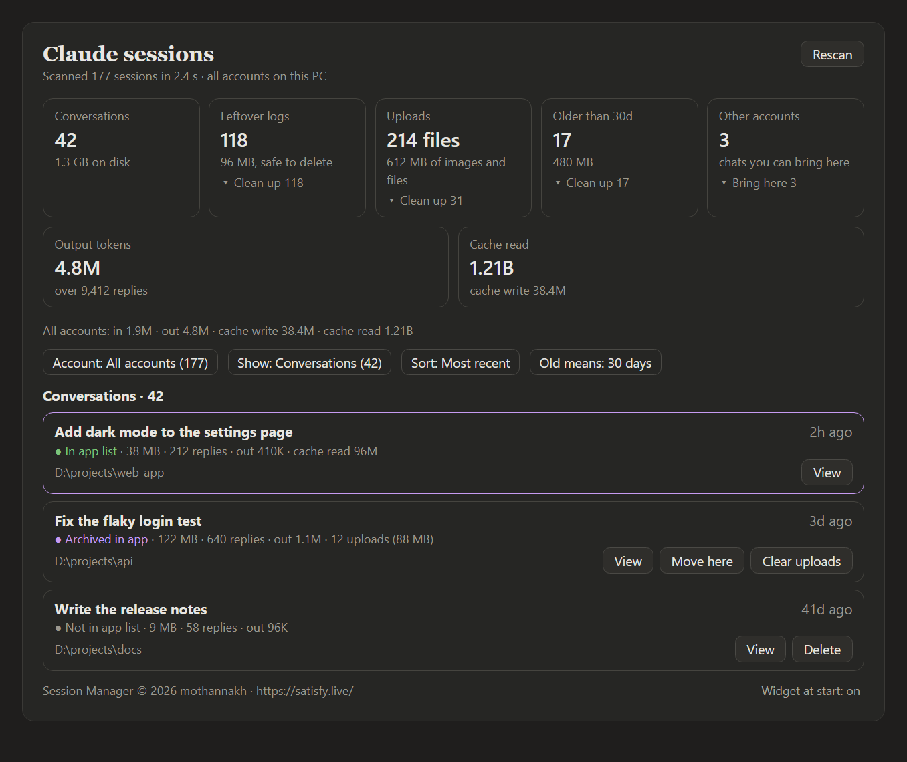
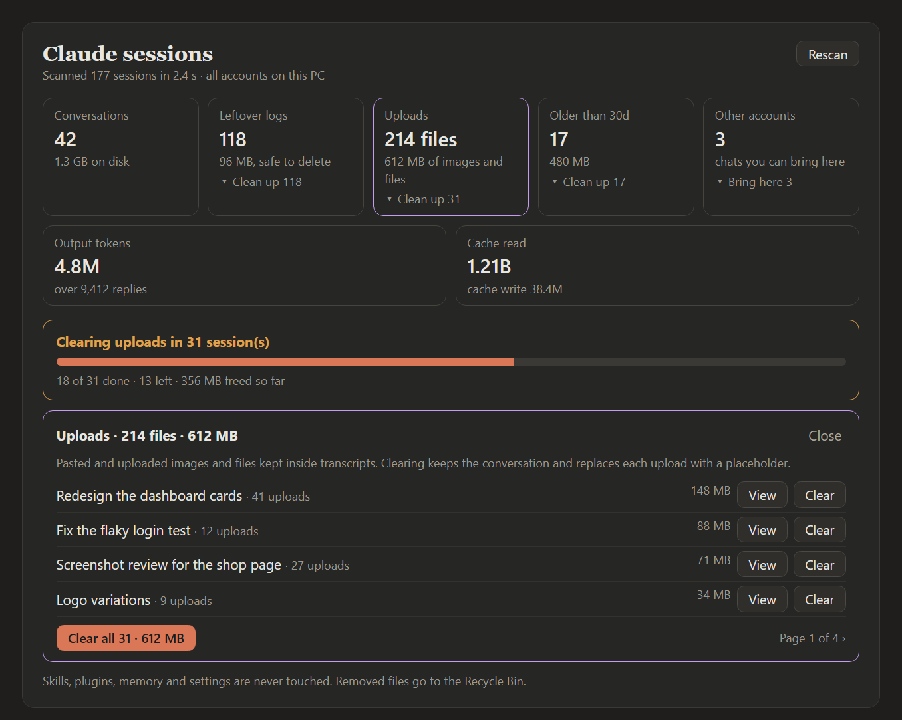
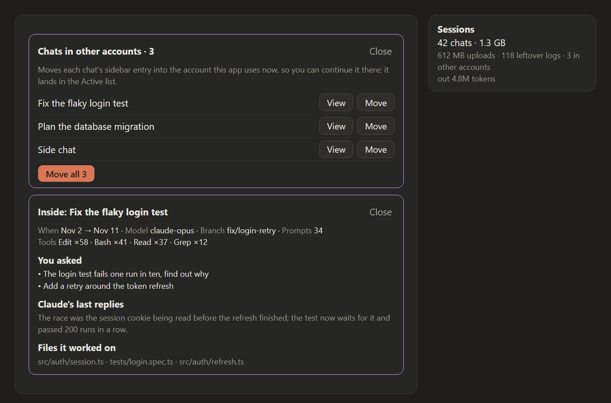

# Session Manager for Claude Code

[](https://github.com/mothannakhzaleh/claude-session-manager/releases/latest)
[](https://github.com/mothannakhzaleh/claude-session-manager/actions/workflows/release.yml)
[](https://github.com/mothannakhzaleh/claude-session-manager/actions/workflows/check.yml)
[](LICENSE)


See every Claude Code session on your PC, for every Claude account, in one pane: what each one cost in tokens, how much disk it uses and what is inside it. Then clean up safely: clear uploaded images and files, delete old sessions and leftover logs, and move chats from another account into the one you use now.



## What it does

- **Every session, every account.** Lists Claude Code sessions from all accounts and Windows users on the PC, grouped by account, with filters (conversations, leftover logs, with uploads, older than N days) and sorting (recent, largest, most tokens).
- **Token totals.** Input, output, cache write and cache read for each session, each account and everything together. Each reply is counted once, and subagent runs are included.
- **Clear uploads.** Pasted screenshots and uploaded files stay inside transcripts and can take hundreds of MB. Clearing keeps the conversation and puts a small placeholder where each upload was.
- **Delete old sessions and leftover logs.** Background summary runs ("Below is a conversation log…") pile up with no real replies. One click removes them, along with old conversations you no longer use.
- **Cards with their own cleanup.** Click a tile (Leftover logs, Uploads, Older than 30 days, Other accounts) to open a card listing just those items, with a button for each one and one for all of them.
- **Progress bar.** Shows what is done, what is left and how much space has been freed so far.
- **View what is inside a chat.** When it ran, model, branch, what you asked, Claude's last replies, the tools it used and the files it worked on, without opening the chat.
- **Bring chats from another account.** Moves a chat's sidebar entry into the account the Claude app uses now, so you can continue it there. It lands in your Active list. The conversation itself stays where it is, so nothing is duplicated or left behind.
- **Restore deleted chats to the sidebar.** A chat you deleted in the app often still has its conversation on disk ("Deleted in app, files left"). **Restore to sidebar** gives it a new entry in your Active list so you can continue it. The conversation is not changed.
- **Small widget.** In the Claude desktop app a small Sessions widget opens beside the chat with the main numbers. Turn it off from the pane footer.





*The pictures show example data.*

## Safe by design

- Skills, plugins, mods, memory, agents, commands, hooks and settings are never touched: the helper only accepts session files by their exact shape and refuses anything inside those folders.
- The session you are using, sessions open in a running Claude process, and sessions written in the last 15 minutes are skipped.
- Conversations still in the app's list are not deleted here. Delete them in the app first; their leftover files can then be cleared here.
- Deleted and replaced files go to the **Recycle Bin**, so you can restore them.
- Every delete, clear and move asks you first.
- Credentials are never read. Of the account file it reads only the account id, email and organization name, to label accounts on your screen. Nothing is sent anywhere.

## Requirements

- Windows 10 or 11 with Claude Code (the desktop app or the terminal).
- **Node.js 18 or newer.** If it is missing, the pane shows an **Install Node.js** button that installs the LTS version with winget (Windows' package manager) from the official `OpenJS.NodeJS.LTS` package. Windows may ask for permission. You can also install it yourself from [nodejs.org](https://nodejs.org).

## Install

In Claude Code, type:

```
/plugin install session-manager --marketplace mothannakhzaleh/claude-session-manager
```

Or from a terminal:

```bash
claude plugin install session-manager --marketplace mothannakhzaleh/claude-session-manager
```

Then start a new session and type `/sessions` to open the pane.

## Use

- `/sessions` opens the pane. The first scan reads every transcript once (about 20 seconds on a large history). After that, only changed files are read again.
- Click a tile's **Clean up** or **Bring here** to open its card.
- **View** on any session shows what is inside it.
- Moved chats show in the sidebar after you restart the Claude app.

## Updating

Every change pushed to this repository is released as a new version automatically: a GitHub Action raises the version number, tags it and publishes a [Release](https://github.com/mothannakhzaleh/claude-session-manager/releases) with the changes.

**Get updates without doing anything (recommended, once):** in Claude Code, type `/plugin`, open **Marketplaces**, select **claude-session-manager** and choose **Enable auto-update**. Marketplaces other than Anthropic's start with auto-update off, so this one step is needed. After that, Claude Code checks for new versions in the background after your first message in a session, and loads them the next time it starts (or right away with `/reload-plugins`).

**Update by hand:**

- In Claude Code: `/plugin marketplace update claude-session-manager`, then `/plugin` → **Installed** → **session-manager** → **Update now**.
- From a terminal:

  ```bash
  claude plugin marketplace update claude-session-manager
  ```

  ```bash
  claude plugin update session-manager@claude-session-manager
  ```

## Help and contributing

- Questions and ideas: [Discussions](https://github.com/mothannakhzaleh/claude-session-manager/discussions)
- Bugs: [open an issue](https://github.com/mothannakhzaleh/claude-session-manager/issues/new/choose)
- Want to help? Read [CONTRIBUTING.md](CONTRIBUTING.md). Security problems: [SECURITY.md](SECURITY.md).

## License

MIT © 2026 mothannakh · [satisfy.live](https://satisfy.live/)
